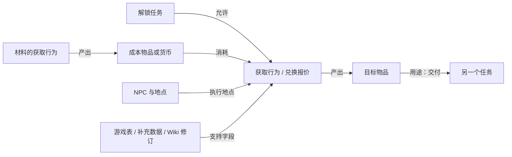

# 物品获取来源分析与改进方案

调研时间：2026-10-23 至 2026-10-24（Asia/Shanghai）

对象：本项目的全物品来源能力；本文是分析与实施建议，未修改产品代码。

## 1. 结论

建议把来源能力建设为**按 Item ID 索引的、带条件和证据的获取关系图**，再从关系图生成给玩家看的说明。单独增加几个分类名称，或将 `detail` 写得更长，无法解决目前的问题。

玩家需要得到的结果应当回答：

> **通过什么行为获得、在哪里、找谁、交什么、得到多少、需要满足什么条件，以及前置材料从哪里来。**

推荐分工：

1. **游戏表是基础事实来源**：物品、制作配方、采集、任务奖励、商店报价、职业等级、探索任务等。
2. **LuminaSupplemental 补充客户端表没有或不易连接的关系**：掉落、具体宝箱、怪物分布、额外 NPC 地点、种植、远航解锁等；逐数据集检查覆盖及版本。
3. **Wiki 是结果粒度的对照标准，也可作为离线补充证据**：NPC 坐标、复杂获取说明、隐藏条件、地区差异。不能把所有 Wiki 数据强制压成一种表结构，也不应让本地查询依赖每次实时访问 Wiki。

应优先补齐制作、采集、普通雇员探索、任务奖励、成就等本地可确定的来源，同时完善兑换条件和地点。随后补齐掉落/转化细节、间接获取链和复杂人工说明。

“更好的来源”在这里指信息正确、完整、可执行。当前没有玩家进度、市场价格、库存、掉率和耗时的完整数据，不能据此声称某条路线一定最便宜或最快。

## 2. 调研依据与范围

### 2.1 实际使用的数据

- 通过**已经配置好的 Lumina MCP**调用 `describe_sheet`、`list_rows`、`get_row`、`search_rows`；未直接运行 `publish/mcp-lumina.exe`。
- 游戏数据版本：`2026.10.06.0000.0000`；Schema 标识：`latest`。字段名属于 EXDSchema 的 best-effort 解释，不能仅凭名称认定全部业务语义。
- 按用户后续指示，来源判断基于底层表分析，**不以现有 `get_item_sources` 的返回结果判断覆盖情况**。语言问题不在本文修复范围。
- 灰机 Wiki API 已通过浏览器实际读取，使用 `credentials: "omit"`，未提供登录凭据或 API key；成功请求包括 `query+revisions`、`parse`、`paraminfo`、`lua`。
- 阅读本项目来源实现、响应模型，以及用户指定的 [LuminaSupplemental 上游仓库](https://github.com/Critical-Impact/LuminaSupplemental)。

### 2.2 全量盘点：每个有名称的物品都有一条检查记录

本次扫描了 Item 的全部 **52,801 行**，其中 **51,225 行名称非空**。这些是当前安装数据中的有名条目，不等同于当前可获取物品数量；其余 1,576 行不进入有名物品清单。

对以下七张表读取了全部行，提取产出/奖励/兑换目标物品引用：

| 表 | 扫描行数 | 非零正数物品引用去重数 | 统计含义 |
|---|---:|---:|---|
| Recipe | 14,909 | 11,341 | ItemResult |
| GatheringItem | 2,148 | 1,954 | Item；还须确认对应采集点 |
| FishParameter | 2,512 | 2,467 | Item；还须反查全部钓场 |
| RetainerTaskNormal | 983 | 948 | Item；还须连接实际 RetainerTask |
| Achievement | 4,078 | 192 | Item；还须确认领取流程 |
| SpecialShop | 1,489 | 12,987 | 全部 Item[i]Item[j] 接收物品槽 |
| Quest | 5,533 | 3,007 | 固定 Reward[] 与 OptionalItemReward[] |

上述表的正数引用并集为 **29,866 个 ID**，其中 **29,497 个**能对应到本次 Item 的有名条目。另有 **21,728 个有名物品**没有这七类表的引用。

**这些数字是“候选关系盘点”，不是来源完整率、正确率或可获取率。** 无引用物品可能来自怪物、副本、金币商店、宝箱、商城、活动等未计入这七表的渠道；有引用物品也可能存在历史条目、特殊条件或尚未解码的奖励类型。369 个未匹配有名 Item 的引用须单独审查，不能自动当成有效玩家物品。

逐物品清单见 [item-table-reference-audit.json](item-sources-evidence/item-table-reference-audit.json)。文件采用 `columns + rows` 结构，每行包含：

- Item ID、中文名、ItemUICategory；
- 七张表各自引用该物品的**不同 row ID 数**；
- 同一 SpecialShop 的多个兑换行计为一个商店 row，因此这些计数也**不是实际获取路线数量**。

例如加特勒有 SpecialShop 线索；钴铁矿有采集、普通雇员和特殊商店线索；清单没有尝试把未扫描到的 Wiki 补充来源伪装成已验证关系。

## 3. 当前实现与目标之间的主要差距

代码依据：[SupplementalDataService.cs](../../src/McpLumina/Services/SupplementalDataService.cs)、[SupplementalTools.cs](../../src/McpLumina/Tools/SupplementalTools.cs)、[ItemSourcesResponse.cs](../../src/McpLumina/Models/Responses/ItemSourcesResponse.cs)。

| 问题 | 现有实现依据 | 对玩家结果的影响 |
|---|---|---|
| 覆盖的获取机制不够 | Service 56–81、179–203：以补充 CSV、GilShopItem、SpecialShop 为主 | 没有普通 Recipe、采矿园艺、捕鱼、任务奖励、成就奖励的完整反向索引 |
| 获取、消耗、解锁混用 | Tools 351–358 把 QuestRequiredItem 加入 sources | “任务需要交这个物品”可能被误解为“任务奖励这个物品” |
| 成本和产量变成自由文本 | Tools 217–240、342–349 | 调用方难以正确比较多材料、多个报价、HQ、收藏价值 |
| 条件未进入报价模型 | Service 188–200 只取物品、成本、接收数量 | 商店解锁任务、单行任务、成就与活动条件丢失 |
| NPC 路由过浅 | Service 212–231 直接 ENpcData 命中商店并合并 ENpcShop | 间接菜单中的商店可能缺 NPC；缺坐标和菜单路径 |
| 副本粒度丢失 | Service 120–125、Tools 266–288 | 能说出副本，却无法保留具体宝箱/首领依据 |
| 普通雇员委托缺失 | Service 78、Tools 305–311 处理随机表 | 明明能指定筹集的物品只剩探索表编号或没有这条来源 |
| 来源数量语义不稳定 | 每个 NPC 展开一条同报价记录 | 同一兑换在多个地点出现，被算成多个获取办法 |
| 未知与失败不可区分 | Service 149–162、184、203、226 的空结果/警告降级 | “未实现”“加载失败”“确实无记录”都可能表现为空 |
| 概率不可审计 | Tools 459–479 生成字符串 | 缺失概率、确定获得、观测掉率等无法可靠区分 |

上述是实现结构审查结论，不依赖有语言问题的聚合接口。

## 4. “加特勒”应达到什么效果

### 4.1 玩家可直接使用的输出

> **加特勒 ×1：兑换获得**
>
> 前往 **黑衣森林中央林区（X:21.9，Y:22.6）**，与 **科纳格流派商人〈贸易人员〉** 对话，进入 **“高纯度兽核晶”** 商店。
>
> 交付 **兽主手斧+4 ×1** 和 **高纯度兽核晶 ×20**。
>
> 商店条件：完成 **“贪食无厌加特勒”**。
>
> 本条兑换条件：完成 **“奇盘上的王者：高段第二盘”**。
>
> 两种材料分别可展开查看获取途径。

这比“特殊商店”“兑换”“某个 NPC”更接近可执行说明。页面展示可以折叠前置链，但不能隐藏必需条件。

依据：[Wiki 物品页](https://ff14.huijiwiki.com/wiki/物品:加特勒)、[结构化数据页](https://ff14.huijiwiki.com/wiki/Data:Item/50777.json)。本次实际 API 数据页修订号 `2375330`，时间 `2026-09-08T18:10:42Z`；渲染页修订号 `2362351`。

### 4.2 已核对的表链

| 信息 | Lumina 实证 | Wiki 对照 |
|---|---|---|
| 目标物品 | Item/50777 | ID 50777 |
| 商店 | SpecialShop/1771020，Name=高纯度兽核晶 | 商店ID 1771020 |
| 兑换行 | `Item[37]` | `兑换信息.index=38`，这里为一基序号 |
| 产出 | Item[37]Item[0]=50777，ReceiveCount[0]=1 | 加特勒 ×1 |
| 成本一 | ItemCost[0]=50770，CurrencyCost[0]=1 | 兽主手斧+4 ×1 |
| 成本二 | ItemCost[1]=51735，CurrencyCost[1]=20 | 高纯度兽核晶 ×20 |
| 商店任务 | SpecialShop.Quest=71034 | 贪食无厌加特勒 |
| 单行任务 | Item[37]Quest=71037 | 奇盘上的王者：高段第二盘 |
| 商人 | ENpcBase/1059408 的 ENpcData[2]=1771020 | 科纳格流派商人 |
| NPC 名称 | ENpcResident/1059408 | 名称和称号一致 |
| 地点 | 本次未完成本地坐标反查 | Wiki 提供中央林区 21.9/22.6 |

特别注意：

- Item/50777 的 `PriceMid=99999` **不是存在 99,999 金币购买途径的证据**，必须有实际商店售卖关系。
- ENpcResident 的字段名 `Map` 不能未经语义验证就拿去解释为玩家坐标或 Wiki 地图 ID；本样本底层值为 3，Wiki 位置 ID 为 4。
- 本例 `UseCurrencyType=2`，且两个成本与 Wiki 物品 ID 一致；这只验证了本例，不能推广为所有模式都直接引用 Item。
- 兑换产出、AND 成本、商店条件、单行条件应属于**同一条报价**。
- “改良型加特勒”是另一个 Item ID 51739。名称模糊命中不能替代准确物品识别。
- 本地 `PatchNumber=750` 与 Wiki 物品数据中的版本标记 7.56 不应被直接判定冲突：字段可能分别描述兑换条目和物品/地区版本，须保留原义。

## 5. 面向所有物品的来源机制与表关系

下表是实现覆盖清单。标记 **表证** 的字段/表已在本次 MCP 中读取；**补充**为补充库/社区关系；**待专项验证**表示存在候选数据，但没有在本次完成整条业务链验收。

| 获取机制 | 正确的反向关联方向 | 最低可展示信息 | 本次证据与边界 |
|---|---|---|---|
| 金币购买 | Item ← GilShopItem 子行 ← GilShop/菜单 ← NPC | 价格、HQ、NPC、区域坐标、条件 | 表证：GilShopItem 有 QuestRequired[]、AchievementRequired、StateRequired、Patch、IsHQ；基础价格不等于所有商店最终价格 |
| 物品/货币兑换 | Item ← SpecialShop 接收槽 ← 报价成本/条件 ← NPC 路由 | 收入数量、完整 AND 成本、菜单、双层条件 | 加特勒已逐字段核对；货币模式须单独解析 |
| 军票等专门商店 | Item ← GCScripShopItem 等专用交易表 ← 商店/阵营 | 军票数量、军衔、阵营、NPC | 表证：CostGCSeals、Item、RequiredGrandCompanyRank；其他专门交易系统待逐类适配 |
| 普通制作 | Item ← Recipe.ItemResult | 制作职业、等级、产量、全部材料/碎晶、秘籍/任务 | 表证；不能用“可分解”代替“可以制作” |
| 采矿/园艺 | Item ← GatheringItem ← GatheringPointBase.Item[] ← GatheringPoint | 职业、物品等级、点等级、区域、坐标、时间窗口 | 表证；Base.Item[] 引用 GatheringItem ID，不是 Item ID |
| 钓鱼 | Item ← FishParameter，以及 FishingSpot.Item[] 反查 | 所有钓场、捕鱼等级；已知时补鱼饵、时间天气等 | 表证；单个 FishParameter.FishingSpot 不足以枚举全部钓场 |
| 刺鱼 | Item ← SpearfishingItem ← SpearfishingNotebook | 水域、等级、鱼影/鱼群条件、坐标 | 表证；生态/连锁表部分字段仍未知，不能凭命名补出条件 |
| 任务奖励 | Item ← Quest.Reward[] / OptionalItemReward[] | 任务名、数量、固定或择一、职业/等级、重复性 | 表证；需额外处理职业奖励及特殊脚本，非只有一组数组 |
| 理符奖励 | Item ← LeveRewardItemGroup ← LeveRewardItem ← Leve | 理符名、奖励组、数量、HQ、组概率、受理地点 | 已验证样例链；组概率不是每个物品独立掉率 |
| 成就奖励 | Item ← Achievement.Item | 成就、目标、领取步骤 | 表证；有 Item 字段不等于自动发到背包 |
| 普通雇员筹集 | Item ← RetainerTaskNormal ← RetainerTask.Task | 职业、等级、能力需求、探险币、时间、数量档位 | 表证；数量随属性档位变化 |
| 随机雇员探索 | Item ← RetainerVentureItem ← RetainerTaskRandom / RetainerTask | 探索名称、职业等级、费用、随机性 | 补充产出池；不能把随机池关系写成保证获得 |
| 普通怪物掉落 | Item ← MobDrop ← BNpcName/BNpcLink/MobSpawn | 怪物名、地图、等级/位置、未知掉率说明 | 补充；同名怪可能有多个实体/地点 |
| 副本首领/宝箱 | Item ← DungeonBossDrop / DungeonBossChest / DungeonChestItem / DungeonDrop | 副本、首领或宝箱、数量、分配条件 | 补充；保留 chest/boss/fight 的原始身份 |
| FATE 奖励 | Item ← FateItem ← Fate | FATE 名、地区、等级、前置链、奖励条件 | 表证 Fate 有 Location、RequiredQuest、RequiredQuest2、FATEChain；奖励池依赖补充 |
| 潜艇/飞空艇 | Item ← SubmarineDrop / AirshipDrop ← 航区及 Unlock | 航区、航行等级、解锁链、必要能力条件 | 表证 RankReq；能力门槛和数量依资料支持程度展示 |
| 开箱/卡包/深层迷宫等 | Item ← ItemSupplement / FieldOpCoffer 等 ← 上游容器/内容 | 容器名、打开/鉴定动作、产量、随机性、容器来源 | 不能把所有容器都概括为“副本掉落” |
| 分解/精选 | Item ← ItemSupplement ← 输入物品 | 输入物品、动作、数量范围、条件、概率证据 | `Item.Desynth/AetherialReduce` 仅说明可执行动作，不自动给出产出池 |
| 种植/杂交 | Item ← GardeningCrossbreed / ItemSupplement ← 种子组合 | 种子、杂交组合、动作、已知条件、随机性 | 种子组合关系不等于完整园艺操作攻略 |
| 寻宝 | Item ← 经验证的地图奖励关系 ← 地图/宝库 | 地图种类、宝库/阶段、直接或间接掉落 | Wiki 钴铁锭提供寻宝来源；不是仅用 TreasureSpot 就能恢复奖励池 |
| 特殊区域、兑换升级、特殊对话 | Item ← 多条前置关系及人工规则 | 内容名称、前置物品/任务、实际交互步骤 | 永恒角笛是仅通用表无法直接讲清楚的实证 |
| 商城、礼包、活动、兑换码 | Item ← 外部商品/活动证据 | 渠道、地区、期限、可用状态、链接 | 补充库与 Wiki 均只作有版本的证据，不能把国际服商城等同国服 |
| 玩家交易 | Item 的交易限制 + 市场资格规则 | “可考虑玩家交易”的提示 | IsUntradable=false 不证明可上市场板，更不证明有库存或最低价 |
| 暂无已知来源/历史来源 | 各提供者检查状态 + 有明确依据的历史记录 | 未知原因、版本、历史途径 | 不得由“来源数组为空”推导“绝版” |

### 5.1 制作：产物与材料方向必须分开

实证：钴铁锭 Item/5059 对应 Recipe/153 和 /273：

- 两条配方均产出 1 个；各需钴铁矿 5116 ×2、铁矿 5111 ×1。
- 两条分别使用火之碎晶 Item/2 ×5、冰之碎晶 Item/3 ×5。
- CraftType 分别为 1/2；RecipeLevelTable 为 42。Wiki 对照为 42 级锻铁匠/铸甲匠。
- `Ingredient[6]` 也是真实材料槽，不能仅抽前六种材料；`-1` 等无效占位不能当物品 ID。
- 展示一条路线内的材料 AND，保留两种制作职业之间的 OR。
- RecipeLevelTable 的 row ID 一般不能直接当职业等级，必须读取 `ClassJobLevel`。
- “用于制作某物”是 uses，不是该物的获取来源。

### 5.2 采集：物品等级、节点等级与地点要分开

钴铁矿的实证链：

```text
Item 5116
  ← GatheringItem 65：GatheringItemLevel=47
  ← GatheringPointBase 189：GatheringLevel=50
  ← GatheringPoint 30536/30537/30538/30539
       TerritoryType=147，PlaceName=258
```

Wiki 渲染对照是 **采矿工、物品采集等级47、50级采集点、北萨纳兰 X23.3/Y24.3**。本地四个点属于同一基础节点组，不能简单展示成四种来源。

限时/刻限节点还需连接 `GatheringPointTransient.GatheringRarePopTimeTable/EphemeralStartTime/EphemeralEndTime`，并验证时间单位、时区、跨日窗口；`GatheringItem.RequiredQuest/IsHidden` 也不能丢失。坐标须区分世界坐标、地图原始坐标、玩家显示坐标，按 Map 比例/偏移正确换算。不能直接显示表中的原始数值。

### 5.3 捕鱼：单向引用不够，Wiki 也不是完整鱼类攻略数据库

公主鳟 Item/4930：

- FishParameter/11 指向 FishingSpot/39；
- FishingSpot/39 的 Item[3]=4930；
- Wiki Data 实际列出 4 个钓场。因此应反向枚举 FishingSpot.Item[]，不能把一个主钓场当成全部。
- RetainerTaskNormal/311 同时提供普通捕鱼筹集，Wiki 还有 NPC 金币商店；这些应成为并列路线。
- 当前读取的 FishParameter/FishingSpot 并没有完整的鱼饵、天气转换、鱼王触发字段；不能根据钓场存在就宣称知道完整钓鱼条件。
- 本次 Wiki 公主鳟渲染页把进一步钓场/鱼饵信息引向“鱼糕”。“达到 Wiki 效果”不应被扩张为“所有鱼都有本地完整攻略”。

刺鱼样例：SpearfishingItem/20002 的 Item=20146，Notebook=1；Notebook/1 指向 GatheringPointBase/465、TerritoryType/613、PlaceName/2512、GatheringLevel=65。其原始 X=1344/Y=516 不是可直接给玩家的 1344/516 坐标。

### 5.4 任务、理符与成就：三个方向和奖励分组

必须分别建模：

- **奖励**：任务完成后得到目标物品；
- **消耗**：任务要求提交目标物品；
- **解锁**：某任务完成后才允许另一个获取行为。

本地 Quest/65537“招募冒险者”固定奖励 Item/4551 恢复药 ×2；Achievement/7“战争女神的垂青”引用 Item/2907 残戮者之冠。Wiki 的独角兽笛 Item/6269 则提供任务 65730“我唯一的希望”，可作为后续跨源回归样本。

Quest 的 `Reward[]` 与 `OptionalItemReward[]` 要分别保留固定奖励和择一奖励，数量、HQ、职业条件、重复性也要保留。QuestClassJobReward 同时含 RewardItem/RequiredItem，不允许无方向地聚合。脚本型奖励仍可能缺失，不能把这些数组当作全部任务奖励机制。

理符实证：Leve/21 → LeveRewardItem/2 → 奖励组 1（90）/3（10）。两个组前两项数量分别为 3/24。应该保留“奖励组及组概率”，不能机械给每个物品标一个独立掉率。

### 5.5 兑换：货币模式、菜单路由、条件继承

1. 反向索引的单位必须是**商店 row + 条目 index + 输出槽**，不能只保留 Shop ID。
2. 相同条目内多个成本是 AND；不同兑换条目是 OR；一个条目多输出时还要保留同一次交易的关联。
3. 表级 `Quest/CustomTalk/RequiredContentFinderCondition/RequiredFestival` 等条件，与条目级 `Quest/AchievementUnlock/CollectabilityCost/ReceiveHq` 分层保留。
4. `UseCurrencyType`、`CostType[]` 必须先经过模式解析。无法解析时保留原始编码并标记未知，禁止直接拼成某个 Item 的名字。
5. 本次 TomestonesItem 的真实字段是 `Item/Tomestones/CurrencyInventorySlot`。row 3 的值为 28/1/6；“6”不能凭猜测解释成“当前/上代货币”分类。
6. 已验证 TopicSelect/3276802 的 Shop[0]/[1] 指向 1769579/1769605，证明菜单中间节点确实存在。InclusionShop → InclusionShopCategory → InclusionShopSeries → SpecialShop 也应支持；子行表要保留 subrow。
7. NPC 位置允许一对多，条件可能只在特定阶段成立。不能为了“直观”保留一个没有依据的固定坐标。

## 6. LuminaSupplemental 的正确使用方式

本地依赖版本为 `LuminaSupplemental.Excel 5.1.4`。本次上游查询的版本/commit、模型字段和差异详见 [依赖参考记录](item-sources-evidence/lumina-supplemental-reference.md)，不要把上游现状当成本地包内容。

本次上游默认分支源码标注 5.1.5，固定提交为 `2a04329e5fb3ca6f22bc8d1915fe0d1382d59519`；与本机 5.1.4 包记录的提交相比，主要更新了多类 CSV，模型文件没有变化。这不是对 NuGet 最新发布状态的核查。

上游 README 明确说明其用途是补充游戏表之外的数据；不同数据集来自手工整理、社区观测、游戏数据等。[上游说明](https://github.com/Critical-Impact/LuminaSupplemental#readme)

当前代码没有充分利用的方向包括：

| 补充关系 | 改进用途 | 仍不能保证的内容 |
|---|---|---|
| ENpcPlace、ENpcShop、ShopName、HouseVendor | 补地点/商店路由与名称、处理住宅商人重复 | NPC 动态阶段、所有地区版本、完整菜单条件 |
| BNpcLink、MobSpawn | 将名称、怪物实体与多个刷新点连接 | 所有怪物的实时位置、完整掉率 |
| DungeonBoss、DungeonChest 等 | 保留首领、战斗序号、宝箱身份与位置 | 版本性周限制、拾取分配、样本未覆盖的掉落 |
| GardeningCrossbreed | 保留种子组合和杂交结果 | 完整土壤、摆放、照料等操作条件 |
| AirshipUnlock、SubmarineUnlock | 展开航区解锁链 | 无数据支持的能力阈值与最优航线 |
| FieldOpCoffer、ItemSupplement | 区分场景宝箱、开箱、分解、精选 | 未维护的新内容、特殊触发规则 |
| StoreItem、UnobtainableItem、ItemPatch、FestivalName | 建立商城、历史状态、版本、活动名称线索 | 国服/国际服一致性、当前活动开放性 |

必须把每条补充记录的 dataset、版本、源记录和已知局限留在 evidence 中。社区观测的概率只能表达为观测概率；没有概率的怪物→物品对不能补一个“默认掉率”。

有些精度问题来自本项目丢掉了依赖已经提供的字段：DungeonChest 有 MapId/TerritoryTypeId/Position/DungeonBossId；DungeonBossChest 有 FightNo/CofferNo；SubmarineDrop 有 LootTier 及 Normal/Poor/Optimal 数量范围。应先保留这些字段，再逐项核验其显示语义。ItemSupplement 的 Tracky 生成路径会将 Pct ×100 后存入 Probability，但模型未保存样本量；不能把该值标为官方概率。

**仅升级补充库无法解决本项目没有读取 Recipe、GatheringItem、Quest 奖励等基础表的问题，也无法替代 Wiki 人工维护的复合条件。** 是否升级依赖属于后续实现决策，本次未升级或重新发布。

## 7. 灰机 Wiki API：已验证的获取方法

### 7.1 优先读取 Data:Item/{id}.json

物品展示页并不是完整来源数据。加特勒页面 wikitext 主体只是 `{{物品页|id=50777...}}`；页面内容由模块和数据页组合生成。

已成功调用的请求：

```text
GET https://ff14.huijiwiki.com/api.php
  ?action=query
  &format=json
  &formatversion=2
  &prop=revisions
  &titles=Data:Item/50777.json
  &rvprop=ids|timestamp|content|contentmodel
  &rvslots=main
  &redirects=1
```

实际发送时用 URLSearchParams 编码。读取路径：

```text
query.pages[]
  → revisions[0]
  → slots.main.content
  → JSON.parse(...)
  → 来源
```

本次 Data 页的 contentmodel 是 `BSON`，但返回的 content 可作为 JSON 文本解析。不要因为不是 `json` 模型就当成 wikitext；也不要省略内容验证。

可复用的单批读取示例（**接口和解析路径已验证；此封装是示意代码，不是本次新增产品实现**）：

```javascript
async function fetchWikiItemSources(ids) {
  const params = new URLSearchParams({
    action: "query",
    format: "json",
    formatversion: "2",
    prop: "revisions",
    titles: ids.map(id => `Data:Item/${id}.json`).join("|"),
    rvprop: "ids|timestamp|content|contentmodel",
    rvslots: "main",
    redirects: "1"
  });
  const response = await fetch(
    "https://ff14.huijiwiki.com/api.php?" + params,
    { credentials: "omit" }
  );
  if (!response.ok) throw new Error("HTTP " + response.status);
  const body = await response.json();
  if (body.error) throw new Error(body.error.code + ": " + body.error.info);
  return (body.query?.pages ?? []).map(page => {
    if (page.missing || page.invalid) {
      return { title: page.title, status: "missing" };
    }
    const rev = page.revisions?.[0];
    const content = rev?.slots?.main?.content;
    if (typeof content !== "string") {
      return { title: page.title, status: "missing-content" };
    }
    const data = JSON.parse(content);
    const titleMatch = /^Data:Item\/(\d+)\.json$/i.exec(page.title);
    if (!titleMatch || !Number.isInteger(data.ID) ||
        !ids.includes(data.ID) || Number(titleMatch[1]) !== data.ID) {
      throw new Error("Unexpected Item ID in " + page.title);
    }
    return {
      itemId: data.ID,
      title: page.title,
      pageId: page.pageid,
      revisionId: rev.revid,
      revisionTime: rev.timestamp,
      source: data["来源"] ?? null,
      usage: data["用途"] ?? null
    };
  });
}
```

使用小批量 titles 合并查询，并按页面自身返回的 ID 匹配，不能依赖返回顺序。增量同步时保存 revision ID、时间及抓取时间；处理 API error、missing、HTTP 429/5xx 和退避。页面修订与所引用的数据页/模块修订应分别记录，因为数据变化不一定改写物品页 wikitext。

API 通用机制见 [MediaWiki revisions](https://www.mediawiki.org/wiki/API:Revisions)、[parse](https://www.mediawiki.org/wiki/API:Parsing_wikitext)。灰机有自有扩展，最终参数能力应以该站 `action=paraminfo` 为准。

### 7.2 展示对照用 parse，不能只看未展开的 wikitext

```text
action=parse
page=物品:加特勒
prop=text|wikitext|sections|revid|templates
format=json
formatversion=2
redirects=1
```

`parse.text` 可用于验证玩家看到的 NPC、条件、配方和段落是否完整，但 HTML 结构不适合作为主要事实存储。模板说明需要安全渲染/转文本，不能直接信任并执行外来 HTML 或脚本。

`action=lua&module=Item/LinkAsync&id=50777` 也已实际成功，但只返回名称、图标、品质等摘要，**不是来源查询接口**。未发现经过验证的通用 Lua 来源 API，不能凭模块名字编造端点。

### 7.3 “来源”不是固定形状

| 样本 | 数据页实测来源 | 接入时的注意事项 |
|---|---|---|
| 加特勒 50777 | 特殊商店 | 完整对象含 NPC、坐标、报价、双层任务条件 |
| 钴铁矿 5116 | 采集、采集点、雇员探险、特殊商店、理符 | 采集点是 ID 数组；理符是数字 12，不是 12 个任务对象 |
| 钴铁锭 5059 | 寻宝、制作 | 制作是职业/等级/星级摘要，完整材料还需配方表或 parse |
| 公主鳟 4930 | 雇员探险、商店、钓鱼 | 钓鱼为钓场 ID 数组；用途另有制作/任务 |
| 独角兽笛 6269 | 任务 | 来源值是单个对象，不一定都是数组 |
| 二型通用规格神典石 46728 | 副本、特殊商店 | 用途也有“特殊商店”，必须保留关系方向 |
| 吉祥天女羽衣 19124 | 其他、副本 | “其他”中有分解说明，不能丢弃或只显示“其他” |
| 永恒角笛 39486 | 其他 | 复合条件依赖模板文本：任务、四件饰品、持有或装备、NPC 对话 |

Wiki 已有 [物品来源人工补充表](https://ff14.huijiwiki.com/wiki/Data:物品来源/其他.tabx) 和 [采集点补充表](https://ff14.huijiwiki.com/wiki/Data:补充数据/采集点.tabx)。应保留“结构化关系 + 人工说明”两种能力。

不同来源值要由各自 adapter 解析成 `entityRefs / offers / summaryCount / narrative`；数字计数不能伪装成完整列表。模板里的“持有或装备”也不能随意简化成“消耗这些物品”。

### 7.4 可用性与证据边界

本次 Wiki 验证范围为 **8 个 Item JSON、4 个展开页面**；成就物品没有独立的 Wiki 样本核验。本地全目录盘点与 Wiki 抽样对照是两种不同范围的证据。

本次 web 页面读取曾遇 403，PowerShell 原生 HTTPS 读取遇 TLS 错误；随后通过浏览器实际请求上述 API 成功。说明不能根据一种客户端失败就认定 API 不可用。

验证的是当时的匿名只读请求；不代表永久访问政策、写权限或跨域策略。跨站 fetch 并非一律可用，`origin=*` 也不能保证通过 CORS。建议实现为后台/离线同步与本地缓存，不让用户页面直接依赖跨站请求。

Wiki 的某些记录更新时间早于本地游戏版本。跨源比较要以物品 ID、地区版本、修订时间和字段语义判断，不应规定“Wiki 总覆盖本地表”或相反。

## 8. 建议的数据契约与展示方式

### 8.1 三种关系独立保存



关系模型建议：

```text
item
  itemId, names, region, gameVersion

routes[]
  routeId, acquisitionType
  outputs[]                   # itemId, quantity, HQ
  costs[]                     # 同一报价 AND；非消耗持有条件放 requirements
  requirements                # allOf / anyOf，带可审计条件类型
  shopRef, offerIndex, outputIndex
  npcRefs[], locations[]      # typed IDs；坐标标明坐标系/地图/层
  dutyRef, bossRef, chestRef   # 有依据时填写，不强制每类都有
  randomness                  # guaranteed / random / unknown
  probability                 # 数值、单位、适用对象、证据；允许未知
  availability                # current / historical / conditional / unknown
  narrative                   # 复杂规则的有来源说明，允许无法结构化
  upstreamItemRefs[]          # 按需展开
  evidence[]                  # provider, table, row, subrow, index, revision
  unresolvedFields[]

uses[]                        # 消耗/交付/配方材料；不计入获取路线
coverage
  perProvider / perCategory   # scanned / unsupported / failed / partial
  unknownReasons[]
```

稳定 ID 应带实体类型和版本命名空间，如 `SpecialShop:1771020:37:0`；不要继续让一个无类型 `sourceId` 同时表示物品、NPC、副本和商店。

字段来源建议细到“成本由 SpecialShop 支持，位置由 Wiki 修订支持”，而不是整条记录笼统标为“Wiki 来源”。自动解析出来的结构与原始证据都保留。

兼容方面：先添加 routes/uses/coverage 并保留旧字段，`detail` 改为由结构化字段派生。若将旧 sources 中的 quest_required 移除会改变既有契约，应按仓库 semver 规则明确迁移，而非静默改变含义。

### 8.2 展示优先级

每个物品的默认显示应包含：

1. 一句摘要：例如“兑换获得：中央林区的科纳格流派商人”；
2. 路线卡：具体条件、数量、成本、NPC/地点；
3. 同类型不同报价分开，同报价多个 NPC/地点聚合；
4. 材料或容器可展开一至数层上游获取；
5. “用途”“历史来源”“数据不完整”独立区域；
6. 证据链接、数据版本和未确定字段在详情中可查看。

不要展示 `venture table #157` 这类内部编号作为主要说明。没有足够地点证据时，可以显示已确认的商店/内容名以及“位置待补充”，不要制造精确坐标。

### 8.3 上游链展开规则

- “打副本 → 得代币 → 找 NPC 兑换”与“副本直接掉装备”必须区分。
- 多输入兑换、制作是 AND 超边，不能拆成“任何一种材料都能换”。
- 仅在有必要时展开，限制深度、节点数、分支数，检测 A→B→A 环。
- 计算总材料时考虑每次产出数量并向上取整，但本阶段无需做“全局最优获取规划器”。
- 同一 NPC 多商店、多地点与同一内容多种掉落途径应保留身份，去重不能丢失条件或概率对象。

## 9. 数据管线与逐物品实施办法

### 9.1 全量构建与逐物品查询分离

```text
读取版本/表结构
  → 各提供者批量读取并建原始索引
  → 各来源 adapter 规范化方向、数量和条件
  → typed ID 关联实体/地点
  → 生成 itemId → routes / uses / coverage
  → 语言映射与摘要渲染
  → 按需展开上游链
```

保留现有启动期反向索引思路。不要每查询一个物品就扫描一次 Recipe/Quest/SpecialShop，也不要对全部 51,225 个物品逐条同步抓 Wiki。

缓存至少区分：游戏版本、地区、Schema 指纹、补充库/数据版本、Wiki 修订和解析器版本。名称与事实层分开；分页在稳定排序的路线集上执行，分类计数与应用过滤前后的计数语义明确。

当前泛用 `search_rows` 不允许空 query；本次纯数值反查使用 `list_rows` 选择必要字段、批量读取后过滤。后续可增加独立的数值筛选/批量关联接口，不应靠伪造文本 query 查询纯数值表。

### 9.2 每个物品的处理规则

1. 从有名 Item 清单定位准确 ID；同名/包含关系提供候选选择。
2. 检查全部已实现的获取提供者，按目标 Item 建立入边。
3. 把引用该物品作为消耗的关系放到 uses，不作为入边。
4. 对每条入边补齐关联实体、成本、条件和地点；无法解析的字段显式保留。
5. 必要时读取补充库或缓存的 Wiki 数据，逐字段融合并保留来源。
6. 输出“已知路线”和“检查覆盖状态”；零路线并不自动表示不可获取。
7. 对新版本新增物品、零路线物品、缺地点/条件物品建立待补充队列。
8. 将有明确信息的历史不可获取记录单独展示，地区不匹配的记录不参与当前可用判断。

本次逐物品 JSON 可作为后续队列起点，但只有七张表的线索，**不能直接作为新的完整来源数据库发布**。

### 9.3 实施顺序

| 阶段 | 工作 | 完成标准 |
|---|---|---|
| P0 语义基础 | 获取/用途/解锁分离，typed ID，结构化成本，coverage/证据 | 不再将任务交付当来源，不再把失败当无来源 |
| P1 高收益本地来源 | Recipe、采集、普通雇员、任务固定/可选奖励、成就；并补兑换条件 | 本文已验证的样本能够形成可执行路线 |
| P2 商店与补充关系 | 货币模式、菜单路由、NPC 位置、军票商店、具体副本宝箱/首领、远航/种植 | 所需信息保留原始身份，可逐字段追溯 |
| P3 Wiki/人工补充 | Data 页 adapter、修订缓存、复杂规则 narrative、区域/历史状态 | 其他来源不丢弃；未知结构不造成静默漏项 |
| P4 链路与全量验收 | 上游展开、防环、全目录质量统计、分层真值样本 | 同时报告准确性、召回范围、完整度、未知和失败 |

P1/P2 的各类 adapter 可独立开发。Wiki 查询适合用于离线核验和补充，不必阻塞所有纯本地查询。

## 10. 验收标准与后续回归样本

以下是**建议的实现验收**，不是本次已经运行的自动测试。

| 场景 | 建议样本/类型 | 必须验证 |
|---|---|---|
| 双层任务兑换 | 加特勒 50777 | 两种成本、数量、两项条件、NPC、地点、37/38 索引换算 |
| 多制作职业 | 钴铁锭 5059 | 两条配方分别保留，碎晶及产量正确 |
| 采集等级与节点等级不同 | 钴铁矿 5116 | 47/50 不混淆，节点组与物理点不重复算路线 |
| 普通雇员数量档位 | 5116、4930 | 职业/等级、币数、时间、数量范围及属性需求 |
| 多钓场 | 公主鳟 4930 | 反查全部钓场，未知鱼饵/天气不编造 |
| 刺鱼坐标 | Item20146 对应 Notebook1 | 坐标转换正确，原值不直接显示 |
| 固定任务奖励 | 恢复药4551 ← Quest65537 | 奖励2个与交付方向区分 |
| 可选/职业任务奖励 | 含 OptionalItemReward/QuestClassJobReward 的已核验样本 | 择一与固定、职业条件区分 |
| 任务专属物品 | 独角兽笛6269 | Wiki 任务与本地奖励链逐字段比对 |
| 成就奖励 | 残戮者之冠2907 | 成就名与领取步骤，不虚构直接入包 |
| 奖励组概率 | Leve21 | 保留90/10的组语义，不当独立掉率 |
| 双向特殊商店 | 神典石46728 | 获得它的报价与消耗它的报价分离 |
| 嵌套菜单 | TopicSelect3276802 | NPC→菜单→报价路径可追溯 |
| 货币编码模式 | 各 UseCurrencyType 的真实样本 | 模式逐一核验，未知编码不误映射 |
| 多 NPC 同一报价 | 共享商店 | 一个报价、多地点，统计不膨胀 |
| 具体副本/分解 | 吉祥天女羽衣19124 | 直接掉落与分解上游分开 |
| 复杂对话获取 | 永恒角笛39486 | 持有/装备、任务、NPC 条件保留 |
| 当前/历史/地区差异 | 有明确外部证据的活动/商城物品 | 不把全球/历史记录套用于国服当前 |
| 零记录、失败、未实现 | 人工构造及真实边界 | coverage 三者可区分 |
| 多跳与环 | 兑换升级链/互换链 | 数量、AND/OR、防环与截断提示正确 |

建议同时报告：

- **关系准确性**：方向、实体、成本、数量、条件是否逐字段一致；
- **限定真值集召回**：相对于固定版本的人工核验/Wiki样本，不声称得到未知全集的真实 recall；
- **信息完整度**：NPC/区域/坐标、条件、概率证据各自的完整比例；
- **全目录覆盖状态**：已有路线、待补充、未实现、提供者失败、历史证据分别统计；
- **性能**：首次建索引、缓存命中单物品查询、批量查询、链路展开的耗时和内存分别测量。

本次没有更改代码，因此没有用 build/test 通过来替代来源正确性证明。实际验证包括 MCP 全表读取、样本关联、Wiki API/渲染对照与证据文件一致性检查。

## 11. 附件与复核入口

- [逐物品候选表关系清单：51,225 条](item-sources-evidence/item-table-reference-audit.json)
- [本地表结构与关键样本](item-sources-evidence/lumina-table-samples.json)
- [刺鱼、FATE、航区、货币、菜单、理符等补充表证](item-sources-evidence/additional-sheet-schemas.json)
- [Wiki API 请求、状态码、修订号与样本](item-sources-evidence/wiki-api/2026-10-23-api-verification.json)
- [Wiki API 独立说明与 JavaScript/PowerShell 示例](item-sources-evidence/wiki-api/README.md)
- [LuminaSupplemental 上游版本及模型参考](item-sources-evidence/lumina-supplemental-reference.md)

证据中的时间保留原始 UTC 或偏移时区；Wiki 证据文件名使用开始调研日。JSON 的 source/usage 等英文包装字段是本次证据摘录格式，Wiki 原始数据字段仍是“来源/用途”。

本文完成了全目录候选引用盘点、机制覆盖分析和代表样本对照。**没有宣称逐个物品的全部路线已经人工验证，也没有把 Wiki 当作绝对完整的真值库。**

## 12. 随机抽样实测补充（2026-10-24）

按用户要求补写临时 JavaScript，实际从底层表与项目当前依赖拼接来源，再与 Wiki API 数据比较。主脚本位于 [tmp/item-source-probe/probe.mjs](../../tmp/item-source-probe/probe.mjs)，实验说明及结论见 [README](../../tmp/item-source-probe/README.md)，全部逐例结果见 [results.md](../../tmp/item-source-probe/results.md)，字段原值和双向差集见 [results.json](../../tmp/item-source-probe/results.json)。这些临时文件需与报告一同保留才能重跑。

样本使用固定 seed `2026-10-24-lumina-wiki-01`，先从本地独立候选池按 Item ID 去重抽样，再查询 Wiki：**40 个子类型 × 3 例 = 120 个类别样本、118 个不同物品**。没有因查询失败或差异换样。118 个 `Data:Item` 页面全部成功读取，额外读取了三个随机制作样本的 `Data:Recipe` 和展开页面；保存每页修订号与原始数据。

| 结果 | 类别样本数 | 判定边界 |
|---|---:|---|
| 部分对齐 | 83 | 核验到关系或字段一致，仍保留未核验项；包含只比计数的 3 个理符样本 |
| 存在差异 | 14 | 合并 Wiki 同类机制、明确 ID 命名空间后，来源集合仍不同 |
| Wiki Item Data 未列对应键/子类 | 15 | 不能推断展开页面没有、游戏中不可获取，或本地关系必然正确 |
| 无法比较 | 8 | 商城跨区 2 例、特殊场景映射 3 例、重建检验映射 3 例未确认 |

最有价值的成功结果是：民兵手链、夏季靛蓝衬衫、宇宙探索用的开心粉三个制作样本，**各 14 项核心检查全部一致**，包括全部直接材料和水晶、产量、职业/等级/星级、制作要求与秘籍物品。三个普通雇员样本的任务实体集合一致，**各 7 项字段检查一致**，包括属性门槛档位。采集和刺鱼的采集点集合、转换后物品等级/星级也全部对齐。配方关联 Data 页按本地候选 ID 获取，尚未独立穷举 Wiki 全部配方；这些成功不等于完整获取链已经验收。

差异并非单纯语言问题。例如，食果花鼠和金属靛染剂在 Wiki 多出来源箱 Item:33441；战果记录 30353 在本地为 Fate:1612，而 Wiki 为 Fate:1620、1628；两种杂交种子在 Wiki 分别多 2 和 29 组输入组合。九宫幻卡：欧米茄的本地副本集合多出 InstanceContent:30071，但共有副本名称一致。具体原值和差集均保留，尚未据此判定哪端过期或错误。

实验还验证了几处必须修复/实现的环节：CFC→InstanceContent、普通/随机产出表→外层 RetainerTask、Notebook→GatheringPointBase、物品等级引用→转换表，以及飞空艇区域名称映射。特殊商店 mode16 出现货币原码 2 对应巧手紫票的情况，不能当 Item:2；当前仍标未验证。金币商店的泛型子行读取没有产生有效 Item，未伪造抽样结果。

本轮固定使用项目依赖 LuminaSupplemental **5.1.4** 的提交 `e9bf1495bf8588d2cf21441ef03f0d9dfe0f790a`，并验证 33 个 CSV 的 Git blob SHA。游戏表均来自已配置的 Lumina MCP，没有执行 exe，也没有采用现有 `get_item_sources` 的输出。没有修改产品代码。

**结论：底层表足以复现一批核心来源数据，但“表中有关系”距离 Wiki 可直接照着操作的完整说明仍有明显差距。** 需要补齐特殊货币、NPC 菜单/坐标、条件与获取链，并对社区关系差集做版本化核验。40 个子类型不是所有游戏机制，军票等专用商店、寻宝、手工活动等未建候选池；每类 3 例也不能作为全量准确率。此次没有做任何样本的完整页面等价验收，不能把这一事实表述成“所有样本都已证明无法达到 Wiki”。

## 13. 获取链临时实现（初版记录）

随后按用户确认补了临时获取链脚本，正式 MCP 接口未修改。详见 [副本获取链原型](../../tmp/item-source-probe/chains/README.md)、[22 个目标的树形结果](../../tmp/item-source-probe/chains/results.md)和[分段 Wiki 核验](../../tmp/item-source-probe/chains/verification.md)。支持容器和兑换材料递归展开、AND 成本、OR 路线、兑换数量传播、Boss/场景箱原始证据以及循环/预算截断；未知货币和缺失上游保持显式状态。

22 个目标中，18 个至少存在一条全部材料通到已支持来源证据的关系路径，4 个未闭合。这个结构性指标不等于条件/产量/可获取性验收。25 项独立测试通过；12 项定向 Wiki 分段核验中11项一致，1项为透镜在启动之章2缺少本地 Boss 关联。该批是定向链扩展，不追加到前面的120例随机统计。

## 14. 货币与剩余获取链增量验证

后续在临时脚本中继续补齐，详见 [货币解析与获取链分析](currency-chain-extension.md)。现在逐成本槽按 CostType 解析普通物品、HQ、神典石索引和紫/橙票据；其中 mode16 不再一律未知。26,025 个非空成本槽中 25,459 个身份及显式数量可解，566 个 mode8 隐式金币价格保留未验证。

新增完整配方、采集、雇员、任务、怪物来源和三个已核验副本的诗学奖励。22 个固定目标中，至少一条关系路径通到来源证据的目标由 **18 提升到 21**。木工秘籍第十二卷已经解析为巧手紫票 ×1200，但当前 MCP 的收藏品/老主顾子行读取出现异常，仍不能验证具体交纳品到紫票的完整表链；外部子行诊断没有混入本地图冒充闭合。

48 项临时脚本测试通过；新增 28 项定向 Wiki 集成核验中25项一致、3项差异。差异是庆典礼物箱和两种异闻书籍的来源关系缺失。原12项核验仍为11一致、1差异。数字分别反映结构、测试、字段对照，不是完整页面等价或全量来源准确率。正式接口和产品代码均未修改。

## 15. 战斗装备优先范围

后续重点收敛到战斗职业的武器、防具、饰品及其实际依赖，详见 [战斗装备来源缺口与验收优先级](combat-gear-acquisition-gaps.md)。当前混合样本中的10件战斗装备均有至少一条来源证据路径，但尚未按版本、职业组、部位与来源机制验证完整覆盖。

P0 优先补副本/Boss/箱子定位、兑换材料完整来源、神典石与强化链、NPC/地点/菜单；P1 补开箱与个人奖励条件、历史可用性和制作装备；P2 扩展专用商店、职业任务和特殊装备渠道。染剂、宠物等与战斗装备无关的来源降低优先级。验收目标是让玩家知道“去哪、拿什么、多少、找谁兑换或怎样开箱、有哪些限制”，各项缺失继续显式保留。
